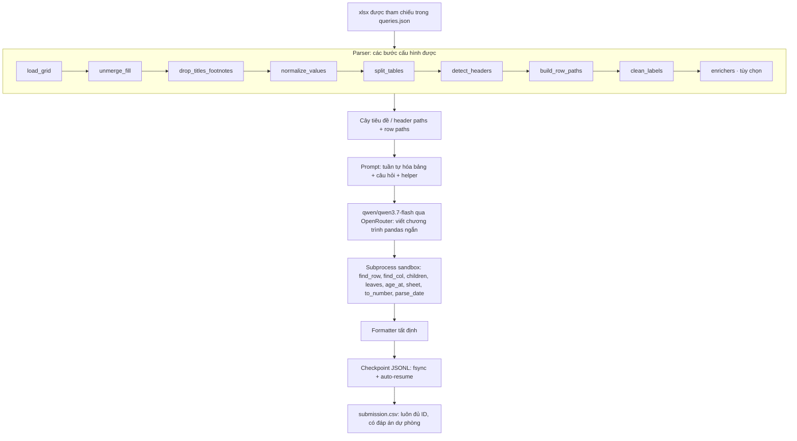

# Neko Core · Excel QA Harness (Bảng C v2)

[](https://github.com/meiiie/bang_c_v2/actions/workflows/ci.yml)
[](https://www.python.org/downloads/)
[](LICENSE)
[](Dockerfile)

**Biến bảng Excel nhiều tầng thành dữ liệu có cấu trúc, dùng LLM viết chương trình pandas ngắn, rồi tính và định dạng đáp án bằng mã tất định.**

Giải pháp của **Neko Core · AI26C0103**, tác giả **Nguyễn Mạnh Hùng**, cho cuộc thi **AI2026 Tài Năng Việt · Vòng Khu vực · Bảng C · Chủ đề 2: “Hỏi đáp trên bảng tính Excel”**.

Repository công khai chỉ phân phối mã nguồn, tài liệu và fixture tổng hợp phục vụ kiểm thử. **Dữ liệu cuộc thi và đáp án chuẩn không được phân phối lại.** Người dùng tự cung cấp dữ liệu hợp lệ khi chạy.

## Kiến trúc



Các đường dẫn tiêu đề và dòng giữ ngữ cảnh phân cấp khi chuyển sang DataFrame. LLM chọn phép tính; subprocess thực thi phép tính; formatter xử lý số, tên nhãn và danh sách. Xem [tài liệu kiến trúc](docs/ARCHITECTURE.md) để hiểu giới hạn và các điểm mở rộng.

## Kết quả thực nghiệm

Các số liệu do tác giả báo cáo, sử dụng **`qwen/qwen3.7-flash`, profile `contest`**. Đây là kết quả của các lượt chạy cụ thể; sai số giữa các lượt vẫn tồn tại và CI không tái lập các phép đo dùng API.

| Hạng mục | Kết quả |
|---|---|
| Public sample | 19/20 |
| Bộ Chặng 2 (30 câu), các lượt chạy | 30/30, 29/30, 28/30 |
| Bộ adversarial tự tạo | 89/90 |
| Bộ robust_hard tự tạo | 56/57 |
| Chi phí quan sát | ≈0.001 USD/câu |
| Thời gian thực cho 20 câu | ~1.5–5 phút |

Các bộ dữ liệu dùng để đo không đi kèm bản xuất công khai này.

## Quickstart

Dùng Python 3.11 trên Linux (sandbox sử dụng giới hạn tài nguyên POSIX), hoặc Docker. Tạo môi trường và cài các gói:

```bash
python3 -m venv .venv
source .venv/bin/activate
pip install -r requirements.txt
export OPENROUTER_API_KEY=your-key-here
python main.py --input DIR --output submission.csv
```

`.env.example` chỉ minh họa tên biến; chương trình không tự nạp file `.env`.

Thư mục `DIR` cần có cấu trúc sau; mỗi phần tử trong `queries.json` có `id`, `file_name`, `query` và có thể có `type`:

```text
DIR/
├── queries.json
└── xlsx_files/
    └── inventory.xlsx
```

Ví dụ câu hỏi hoàn toàn tổng hợp:

```json
[
  {
    "id": "demo_1",
    "file_name": "inventory.xlsx",
    "query": "What is the count for Copper spades? Answer with only the integer.",
    "type": "lookup"
  }
]
```

Đầu ra là CSV UTF-8 có hai cột `id,answer`. Với đầu vào hợp lệ, đọc được và đường dẫn đầu ra ghi được, CLI tạo đủ dòng dự phòng trước khi khởi tạo solver. Đáp án dự phòng giúp giữ cấu trúc file nộp khi lỗi; chúng không đảm bảo đúng nội dung.

### Docker

```bash
docker build -t neko-core-excel-qa .
mkdir -p output

# Cờ --input / --output
docker run --rm -e OPENROUTER_API_KEY \
  -v "$PWD/inputs:/data:ro" -v "$PWD/output:/output" \
  neko-core-excel-qa --input /data --output /output/submission.csv

# Đối số vị trí: thư mục đầu vào, rồi file hoặc thư mục đầu ra
docker run --rm -e OPENROUTER_API_KEY \
  -v "$PWD/inputs:/data:ro" -v "$PWD/output:/output" \
  neko-core-excel-qa /data /output

# Mặc định: /data -> /output/submission.csv
docker run --rm -e OPENROUTER_API_KEY \
  -v "$PWD/inputs:/data:ro" -v "$PWD/output:/output" \
  neko-core-excel-qa
```

Entrypoint cũng hỗ trợ `-i`, `-o`; khi không truyền input, nó ưu tiên `/data/queries.json`, rồi `/input` nếu tồn tại. Container chạy từ thư mục tạm có quyền ghi; checkpoint mặc định nằm cạnh CSV trong volume đầu ra.

**Alias key chỉ trong Docker entrypoint:** nếu chưa có `OPENROUTER_API_KEY`, lần lượt thử `OPENROUTER_KEY`, `OPENROUTER_API`, `API_KEY`. Biến chính đã được đặt, kể cả chuỗi rỗng, có ưu tiên cao nhất. CLI `main.py` đọc biến được cấu hình bởi `api_key_env`.

## Cấu hình

[configs/default.json](configs/default.json) khai báo schema, parser stages, helpers, provider và các ngưỡng vận hành. Thứ tự áp dụng là defaults → profile được chọn → cấu hình file ở cấp gốc → biến môi trường → ghi đè CLI. Profile được chọn bằng `--profile`, rồi `SOLVER_PROFILE`, rồi giá trị trong cấu hình.

| Thiết lập | Hành vi hiện tại |
|---|---|
| `contest` (mặc định) | OpenRouter, khóa model `qwen/qwen3.7-flash`, key `OPENROUTER_API_KEY` |
| `dev-glm` | Profile phát triển tùy chọn: Z.ai, `glm-5.3`, key `ZAI_API_KEY`; không dùng cho lượt thi hay số liệu ở trên |
| `strategy`, `vote_mode` | `vote`, `adaptive`; tối đa `votes=3`, `max_votes=3` |
| `vote_first` | `1`: chấp nhận mẫu thực thi thành công đầu tiên; tăng lên `2` để yêu cầu hai mẫu đầu đồng thuận trước khi dừng |
| `workers`, `program_workers` | 8 câu song song, tối đa 4 chương trình sandbox song song |
| `budget` | 0.03 USD/câu, thấp hơn trần cấu hình cho phép 0.10 USD/câu |
| Timeout của `contest` | Request 40 s; stream tối đa 150 s; first-token 8 s; stall 15 s; mỗi câu 240 s |
| `hedge_after`, `max_hedges` | Sau 20 s có thể mở request dự phòng, tối đa 1 hedge |
| `program_timeout` | 20 s; không cho cấu hình vượt mức này |
| `total_time_limit`, `time_guard_margin` | Guard toàn lượt 2100 s (35 phút), chừa 5 s để kết thúc |
| `serialization`, `prompt_char_budget` | `pipe`, ngân sách phần bảng 9000 ký tự |
| Tính năng tùy chọn | `fast_path`, `verifier`, `hybrid_text`, `sanity_retry` mặc định tắt; `enrichers=[]` |

Các biến thường dùng: `OPENROUTER_API_KEY`, `SOLVER_PROFILE`, `SOLVER_WORKERS`, `SOLVER_BUDGET`, `SOLVER_VOTE_FIRST`, `SOLVER_QUESTION_TIMEOUT`, `SOLVER_TOTAL_TIME_LIMIT`, `OPENROUTER_BASE_URL`. Các khóa cấu hình cấp gốc có thể được ghi đè bằng `SOLVER_<KEY_VIẾT_HOA>`; giá trị được đọc như JSON nếu có thể.

```bash
python main.py --input DIR --output submission.csv --profile contest \
  --workers 4 --budget 0.03 --set vote_first=2

python main.py --input DIR --output submission.csv --config configs/default.json \
  --set question_timeout=180

# Chỉ dựng prompt để kiểm tra parser, không gọi API
python main.py --input DIR --output submission_dump.csv \
  --mode dump --dump-dir prompts
```

## Độ tin cậy

- **Watchdog streaming:** theo dõi thời gian có token đầu và khoảng im lặng giữa các chunk; hạn chế request treo bằng timeout stream và deadline của câu.
- **Hedged requests và fresh retries:** có thể gọi dự phòng khi chậm; lỗi tạm thời được thử lại có giới hạn, tạo client mới theo cấu hình. Hết credit dừng lượt gọi tiếp theo; rescue pass thử cứu câu thất bại trong ngân sách và thời gian còn lại.
- **Checkpoint và resume:** câu giải thành công được ghi vào `<output>.checkpoint.jsonl`, flush và `fsync`. Khóa gắn với ID, câu hỏi, hash workbook, model và cấu hình ảnh hưởng đáp án; chạy lại cùng lệnh sẽ phục hồi các câu phù hợp. Dòng checkpoint cuối bị cắt được xử lý khi đọc lại.
- **CSV nguyên tử:** ghi file tạm, flush, `fsync`, đặt quyền `0644`, rồi `os.replace`. Từng cập nhật vẫn giữ đủ ID và thứ tự đầu vào; các câu chưa xong có đáp án dự phòng.
- **Time guard:** deadline toàn lượt và từng câu ngăn lập lịch vô hạn; giới hạn số worker bị bỏ lại khi request treo để duy trì tiến độ.

```bash
# Tiếp tục từ checkpoint mặc định
python main.py --input DIR --output submission.csv
# Đổi nơi lưu, giải lại từ đầu, hoặc tắt checkpoint
python main.py --input DIR --output submission.csv --checkpoint runs/resume.jsonl
python main.py --input DIR --output submission.csv --fresh
python main.py --input DIR --output submission.csv --no-checkpoint
```

Cam kết về file áp dụng sau khi đọc được `queries.json` hợp lệ và có quyền ghi output. Hỏng filesystem, đầu vào không hợp lệ hoặc bị dừng trước khi ghi không thể được bảo đảm bởi harness. Fallback có thể sai đáp án và không thay thế đánh giá chất lượng.

## Leakage guard

Trong **thư mục input**, solver chỉ đọc `queries.json` và các workbook được câu hỏi tham chiếu trong `xlsx_files/`; không quét thư mục để lấy dữ liệu bổ sung. Kiểm tra đường dẫn chặn traversal và symlink thoát thư mục. File đáp án được đặt cạnh input bị bỏ qua, kể cả khi tính hash provenance.

Chương trình do LLM sinh chạy bằng `python -I` trong thư mục tạm rỗng, kiểm tra AST, giới hạn thời gian/CPU/bộ nhớ và bỏ biến key/token khỏi môi trường con. Audit hook chặn ghi file, đọc file ngoài workbook hiện tại và thư viện Python, mở tiến trình khác và một số đường introspection; socket bị vô hiệu hóa. Đây là lớp phòng vệ chống đọc nhầm/lộ đáp án ở mức Python, **không phải ranh giới bảo mật cấp hệ điều hành cho mã native thù địch**.

Runtime của profile `contest` chỉ gọi model qua OpenRouter; không tìm kiếm web, tải dữ liệu hay gọi web tool. Profile phát triển chỉ hoạt động khi người dùng chủ động chọn.

## Cấu trúc dự án

```text
.
├── main.py                    # CLI, ghi fallback trước khi khởi tạo solver
├── eval.py                    # Chấm exact match trên CSV do người dùng cung cấp
├── configs/default.json       # Profiles, stages, helpers, ngân sách và timeout
├── solver/
│   ├── parser.py              # Excel -> Table, header paths, row paths
│   ├── helpers.py             # Registry helper dùng chung cho prompt và sandbox
│   ├── program.py             # Prompt, kiểm tra và thực thi chương trình
│   ├── llm.py                 # Client, streaming, retry và hedge
│   ├── strategies.py          # Program loop và bỏ phiếu thích ứng
│   ├── pipeline.py            # Điều phối, deadline, provenance và rescue
│   ├── checkpoint.py          # Kết quả bền vững và resume
│   ├── config.py              # Cấu hình, fallback và CSV nguyên tử
│   ├── formatter.py           # Định dạng tất định
│   ├── fast_path.py           # Tra cứu trực tiếp tùy chọn
│   └── sanity.py              # Kiểm tra nhãn/kết quả tùy chọn
├── tests/                     # Test tổng hợp + test tích hợp tùy chọn
├── tools/                     # Đóng ZIP, smoke test, thống kê thời gian/chi phí
├── docs/ARCHITECTURE.md        # Thuyết minh kiến trúc bằng tiếng Việt
├── .github/workflows/ci.yml    # Pytest offline và Docker build
├── Dockerfile
├── docker-entrypoint.py
├── .env.example
├── CONTRIBUTING.md
└── LICENSE
```

## Kiểm thử

```bash
source .venv/bin/activate
pip install -r requirements.txt pytest
unset OPENROUTER_API_KEY
python -m pytest -q
```

Pytest dùng fixture tổng hợp, stub client và transport giả lập; không cần key hay mạng. Test tích hợp dùng workbook phát triển ngoài repo tự skip khi không có thư mục `../data`; test adversarial và oracle cũng skip khi tài nguyên tùy chọn tương ứng không được cài. Không thêm những bộ dữ liệu này vào repository để làm test chạy.

GitHub Actions chạy test trên Python 3.11 không dùng secret và build Docker image trong job riêng, không push image. Đóng gói runtime và smoke test cài sạch:

```bash
python tools/build_zip.py
bash tools/fresh_install_test.sh
```

Smoke test tự tạo workbook nhỏ bằng openpyxl, chạy dump và fallback không key; bước cài dependency cần package index hoặc wheel cache cục bộ (có thể dùng `PIP_NO_INDEX=1 PIP_FIND_LINKS=/path/to/wheels`). ZIP không chứa test, dataset hay kết quả chạy.

## Đánh giá

`eval.py` là công cụ độc lập, chỉ đọc các file bạn chỉ định và không gọi LLM:

```bash
python eval.py --pred submission.csv --gold /path/to/reference.csv
python eval.py --pred submission.csv --gold /path/to/reference.csv \
  --queries /path/to/queries.json
```

So khớp chính xác sau khi bỏ khoảng trắng hai đầu; báo câu thiếu, ID dư và accuracy theo `type` khi có. Nếu không truyền `--queries`, công cụ tìm `queries.json` cạnh file tham chiếu. Người dùng tự chuẩn bị reference CSV bên ngoài repo; solver runtime không dùng file đó.

## Khai báo công cụ hỗ trợ

**Codex CLI** được sử dụng để viết mã dưới sự xem xét và kiểm thử của tác giả **Nguyễn Mạnh Hùng**. **Grok Bot assistant** hỗ trợ điều phối và review. Trong lượt chạy thi (`contest`), LLM duy nhất là **`qwen/qwen3.7-flash` qua OpenRouter**; không có lời gọi tìm kiếm web tại runtime. Profile `dev-glm` được giữ riêng cho phát triển và không thuộc cấu hình thi.

## Nhóm, tác giả và dự án liên quan

**Neko Core · AI26C0103** — **Nguyễn Mạnh Hùng**.

Dự án liên quan: [neko-core](https://github.com/meiiie/neko-core) và [bang_c](https://github.com/meiiie/bang_c). Hướng dẫn đóng góp: [CONTRIBUTING.md](CONTRIBUTING.md).

## English summary

Neko Core Excel QA Harness turns hierarchical Excel sheets into structured tables, asks an LLM to write a short pandas program, executes it in a restricted subprocess, and formats the computed answer deterministically. It was built by **Nguyễn Mạnh Hùng**, team **Neko Core (AI26C0103)**, for AI2026 Tài Năng Việt, Regional Round, Group C, Topic 2.

The default `contest` profile uses only **qwen/qwen3.7-flash via OpenRouter**. It includes streaming watchdogs, hedged requests, bounded retries, per-question budgets, a 35-minute run guard, durable checkpoints with automatic resume, and atomic CSV snapshots with fallback rows. Valid readable queries and writable output are required; fallback rows preserve submission structure, not answer correctness. `dev-glm` is an explicitly selected development profile.

Install with `pip install -r requirements.txt`, export `OPENROUTER_API_KEY`, then run `python main.py --input DIR --output submission.csv`. Docker supports flags, positional paths, and `/data` → `/output/submission.csv` defaults. Run `python -m pytest -q` without an API key for offline tests; unavailable external workbook/oracle fixtures skip cleanly.

**Contest datasets and gold answers are not redistributed.** The input reader uses only queries and referenced workbooks; answer files beside them are ignored. Runtime performs no web searches. Codex CLI assisted code writing under the author's review and testing; Grok Bot assisted orchestration and review.

## License

[MIT](LICENSE) · Copyright (c) 2026 Nguyễn Mạnh Hùng.
