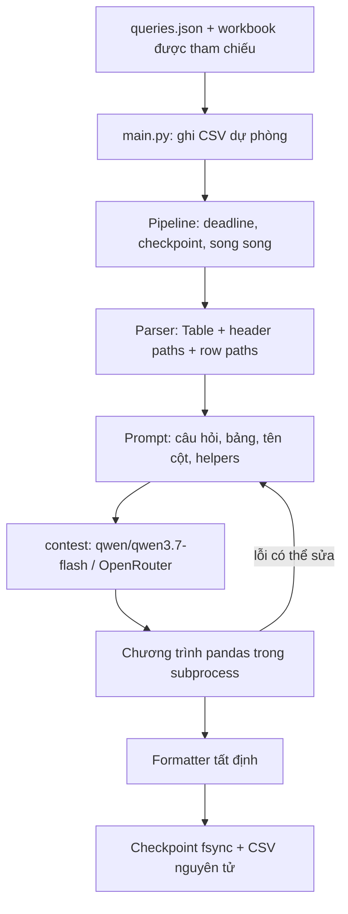

# Kiến trúc Neko Core · Excel QA Harness

Tác giả: **Nguyễn Mạnh Hùng** · Nhóm **Neko Core · AI26C0103**.
AI2026 Tài Năng Việt · Vòng Khu vực · Bảng C · Chủ đề 2: Hỏi đáp trên bảng tính Excel.

Tài liệu được biên tập từ bản thuyết minh kiến trúc của tác giả (`kien_truc.md`),
đối chiếu với `solver/` và `configs/default.json` của bản công khai. Các ví dụ
bên dưới là tổng hợp; không chứa đáp án hay giá trị lấy từ dữ liệu cuộc thi.

## 1. Bài toán và ý tưởng

Đầu vào là `queries.json` và các workbook trong `xlsx_files/`. Mỗi câu có `id`,
`file_name`, `query`, có thể kèm `type`. Đầu ra là CSV hai cột `id,answer`.
Công cụ `eval.py` riêng biệt dùng exact match để đánh giá khi người dùng cung cấp
file tham chiếu; pipeline giải câu hỏi không đọc file tham chiếu đó.

Ý tưởng là giao cho LLM việc chọn dữ liệu và viết phép tính bằng Python/pandas.
Parser giữ cấu trúc phân cấp của bảng; chương trình ngắn thực thi phép tính;
formatter đưa kết quả về định dạng yêu cầu. Cách làm này giúp quan sát lỗi chọn
nhãn, phép tính và định dạng qua các bước riêng, nhưng không loại bỏ lỗi suy luận
hoặc mất dữ liệu khi parser/prompt không biểu diễn hết workbook.

## 2. Luồng xử lý

`main.py` đọc và chuẩn hóa ID rồi ghi ngay các dòng dự phòng, trước khi nạp client
và parser. `Pipeline.solve_all` phục hồi checkpoint trước khi khởi tạo provider,
lập lịch các câu còn thiếu và công bố kết quả theo thứ tự đầu vào. Deadline tổng
35 phút và timeout từng câu giới hạn việc chờ; rescue pass chỉ chạy nếu còn thời
gian và ngân sách.

## 3. Parser: chuỗi bước cấu hình được

`parse_workbook` áp dụng registry `STAGES` theo danh sách `stages`. Thứ tự mặc định:

| Bước | Trách nhiệm |
|---|---|
| `load_grid` | Đọc giá trị Excel, metadata sheet và độ thụt; hỗ trợ chuỗi tham chiếu ô đơn khi công thức chưa có cache |
| `unmerge_fill` | Điền lại ô gộp để giữ các tầng tiêu đề |
| `drop_titles_footnotes` | Loại phần tiêu đề/ghi chú theo heuristic, giữ metadata đơn vị |
| `normalize_values` | Chuẩn hóa số dạng text, phần trăm, dấu âm kế toán, dấu thiếu dữ liệu |
| `split_tables` | Tách các vùng bảng trong cùng sheet |
| `detect_headers` | Xây đường dẫn cột qua các tầng tiêu đề |
| `build_row_paths` | Xây đường dẫn dòng từ section, indentation và quan hệ cha/con |
| `clean_labels` | Làm sạch nhãn, bỏ ký hiệu chú thích, phân biệt khóa trùng |
| `enrichers` | Làm giàu tùy chọn; mặc định không thêm cột |

Ví dụ tổng hợp: đường dẫn cột `Plan > Units > Year A` và đường dẫn dòng
`Garden > Tools > Copper spades` giúp phân biệt các nhãn con trùng nhau.
`Table.to_dataframe()` dùng đường dẫn dòng làm index; phần serialize cung cấp
ngữ cảnh sheet và tên cột cho LLM. Khi heuristic không tìm được bảng dữ liệu số,
parser có biểu diễn raw-grid để giữ nội dung sheet.

Parser không phải công cụ tính toàn bộ công thức Excel. Công thức phức tạp cần
cache có sẵn trong workbook. Ngày dạng text vẫn là text cho đến khi helper xử lý;
giá trị phần trăm lưu theo đơn vị điểm phần trăm. Những quy ước này cần xuất hiện
rõ trong prompt và chương trình tính.

## 4. Prompt, helpers và chiến lược

`program.build_prompt` kết hợp câu hỏi, dữ liệu bảng, tên cột chính xác và mô tả
helpers. `serialization=pipe` là mặc định; `compact` là lựa chọn khác. Ngân sách
ký tự giới hạn phần bảng, có ưu tiên nội dung phù hợp từ khóa; bảng rất lớn có
thể bị cắt bớt nên vẫn cần kiểm tra độ phủ của prompt.

`helpers.py` khai báo một registry dùng chung để dựng prompt và nạp vào sandbox:

| Helper | Công dụng |
|---|---|
| `find_row`, `find_col` | Tìm nhãn theo từ khóa; báo lỗi kèm ứng viên khi không rõ |
| `children`, `leaves` | Làm việc với quan hệ phân cấp của nhãn |
| `age_at` | Tính tuổi tại mốc tham chiếu được chỉ định |
| `sheet` | Chọn bảng theo tên sheet, kiểm tra mơ hồ |
| `to_number` | Chuẩn hóa giá trị số |
| `parse_date` | Đọc ngày text; mặc định ngày/tháng/năm |

`strategies.program` chạy vòng sinh code → thực thi → phản hồi lỗi, có giới hạn
số lần và chi phí. `strategies.vote` chia ngân sách cho các mẫu và chọn kết quả
đa số. Mặc định `vote_mode=adaptive`, `votes=3`, `max_votes=3`, `vote_first=1`:
một mẫu trả lời thực thi được có thể kết thúc sớm. Đặt `vote_first=2` để bắt đầu
bằng hai mẫu và chỉ dừng sớm khi đồng thuận. `verifier`, `hybrid_text`,
`fast_path` và `sanity_retry` là các tùy chọn mặc định tắt, không phải các bước
bắt buộc của mọi câu.

## 5. Client, giới hạn chi phí và thời gian

`llm.py` dùng client tương thích OpenAI. Profile `contest` khóa
`qwen/qwen3.7-flash` qua OpenRouter, lấy key từ `OPENROUTER_API_KEY`. Profile
`dev-glm` là cấu hình phát triển riêng, chỉ dùng khi chủ động chọn.

Streaming theo dõi token đầu và thời gian im lặng. Profile contest đặt
`first_token_timeout=8`, `stall_timeout=15`, `stream_max_seconds=150`,
`request_timeout=40` giây; deadline từng câu là 240 giây. Request chậm có thể mở
hedge sau 20 giây, tối đa một hedge. Retry lỗi tạm thời có giới hạn; tùy cấu hình
có thể dùng client mới và thay đổi thứ tự provider. Lỗi credit dừng gọi tiếp.

Ngân sách mặc định 0.03 USD/câu, validator cho phép tối đa 0.10 USD/câu. Usage
và chi phí được ghi vào log; retry, voting và rescue dùng ngân sách còn lại của
câu. Guard tổng là `total_time_limit=2100` giây, chừa
`time_guard_margin=5` giây. Mặc định có 8 worker câu hỏi và 4 slot thực thi
chương trình; số worker request bị bỏ lại cũng có giới hạn.

## 6. Sandbox và chống rò rỉ

`program.py` trích code, kiểm tra AST, rồi chạy `python -I` trong thư mục tạm
rỗng. Mỗi tiến trình con có giới hạn không gian địa chỉ 700 MiB, CPU 20 giây và
timeout thực thi tối đa 20 giây. Môi trường con loại các biến có tên chứa `KEY`
hoặc `TOKEN`; import cho code sinh được giới hạn ở pandas, math và datetime.

Audit hook cho phép đọc workbook đang giải và thư viện Python để hỗ trợ lazy
imports, chặn các file khác, ghi file, tạo tiến trình và một số cơ chế introspection.
Socket bị vô hiệu hóa. Đây là lớp phòng vệ Python chống đọc nhầm dữ liệu và các
đường thoát đã kiểm thử, không phải sandbox hệ điều hành chống mã native bất kỳ.

Ở phía input, `workbook_path` kiểm tra tên file và giới hạn đường dẫn trong
`xlsx_files/`, bao gồm kiểm tra symlink. Hash provenance chỉ đọc `queries.json`
và các workbook được tham chiếu; không quét thư mục. File đáp án, workbook không
được tham chiếu và các file bổ sung trong input không tham gia dựng prompt.
Runtime contest chỉ gọi API model; không dùng web search hay tải dữ liệu ngoài.

## 7. Formatter, checkpoint và đầu ra

`formatter.py` áp dụng `Decimal` với `ROUND_HALF_UP` cho số chữ số thập phân
được yêu cầu, định dạng số nguyên, boolean Yes/No và danh sách nối bằng dấu phẩy
với một khoảng trắng. Với nhãn phân cấp, nó lấy thành phần cuối, làm sạch chú
thích và dùng cách gọi trong câu hỏi khi có danh sách ứng viên rõ ràng.

Checkpoint mặc định là `<output>.checkpoint.jsonl`. Mỗi câu thành công được
append, flush và `fsync`; khóa phụ thuộc ID, nội dung câu hỏi, hash workbook,
model và hash cấu hình ảnh hưởng đáp án. Chạy lại phục hồi câu phù hợp, không gọi
API cho chúng. Có `--checkpoint PATH`, `--fresh`, `--no-checkpoint`; việc đọc lại
xử lý dòng cuối bị cắt để tiếp tục ghi an toàn.

CSV luôn được ghi thành snapshot đầy đủ qua file tạm cùng thư mục, `fsync`,
`chmod(0644)` rồi `os.replace`. Khi lỗi API, thiếu key hoặc hết thời gian, các
câu chưa thành công giữ đáp án dự phòng. Điều này đảm bảo cấu trúc output với
input hợp lệ đã đọc được và filesystem ghi được, không đảm bảo fallback đúng
đáp án hoặc sống sót qua mọi lỗi phần cứng/dừng tiến trình.

## 8. Quan sát, kiểm thử và mở rộng

Mỗi lượt chạy tạo `runs/<timestamp>/` với manifest cấu hình, hash input, model,
revision nếu có; log câu hỏi và trace sự kiện giúp phân tích lỗi và thời gian.
Không đưa các log chứa dữ liệu riêng lên repository.

Test tổng hợp kiểm tra parser, formatter, sandbox, leakage, checkpoint, retry,
streaming, deadline và quyền CSV. Test phụ thuộc workbook ngoài hoặc oracle tự
skip khi thiếu tài nguyên. CI chạy pytest không secret và build Docker không
push. `tools/build_zip.py` đóng runtime; `tools/fresh_install_test.sh` tạo workbook
tổng hợp trong thư mục tạm để kiểm tra cài sạch và fallback không key.

Có thể mở rộng bằng stage parser, `HelperSpec` hoặc chiến lược trong registry.
Cần giữ helper trong prompt khớp với helper thực thi, bảo toàn giới hạn chi phí,
đường đọc input và khả năng resume. Test hồi quy mới nên dùng fixture tổng hợp
nhỏ, không chép dữ liệu hay đáp án cuộc thi. Kết quả thực nghiệm được ghi trong
[README](../README.md); tài liệu này không lặp lại các số đo cũ của profile phát triển.
